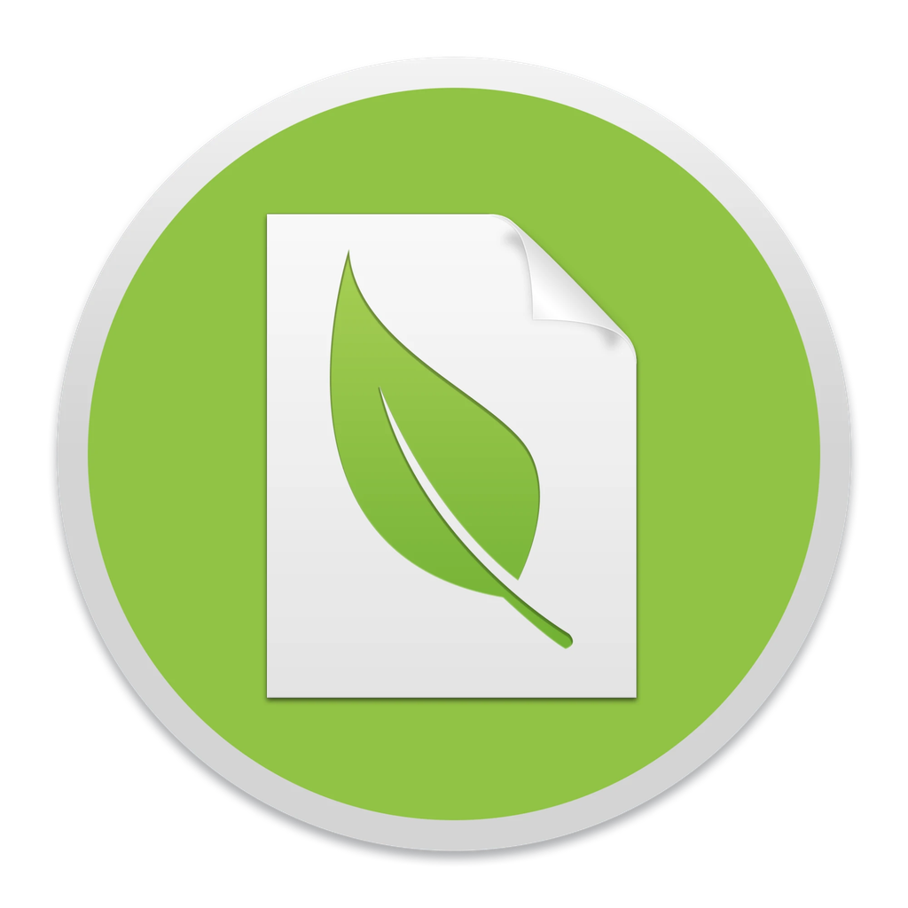

<p align="center">
	
</p>

# Paperless Desktop

[](https://github.com/VIONYT/paperless-desktop/actions/workflows/build.yml)

Native Mac app for [paperless-ngx](https://docs.paperless-ngx.com/): browse, search, edit and upload your documents
without a browser. It runs natively on Apple Silicon (M1, M2, M3, ...) as well as on Intel Macs.

## Features

### Documents

-   **Document list** with thumbnails, tag dots, the creation date and endless scrolling. Long titles are cut at 1.5 lines.
-   **Search** in the full text of all documents (`⌘F`), filter by **correspondent** or **tag** in the sidebar.
-   **New documents appear by themselves**, the list checks the server in the interval you set in the settings.
-   **Document view** with the PDF (rendered with [pdf.js](https://mozilla.github.io/pdf.js/)) or the image next to a form for
    title, correspondent, content, tags and date. Save, download the file, delete or add a reminder from the toolbar.
-   **Multiple selection**: `⌘`-click or the check mark at the thumbnail selects, `⇧`-click selects a range,
    `Escape` clears the selection. A bar shows how many documents are selected and offers the bulk actions
    correspondent, tags (with check marks, a tag is added to all or removed from all) and delete.
-   **Context menu** (right click) on a document or on the selection: edit, assign a correspondent, add or remove tags, delete.

### Upload

-   Upload with the green **+ button**, with **drag & drop** (a gray translucent layer with an upload symbol shows where to drop)
    or with `⌘O`.
-   A **widget** shows the progress in percent and the upload speed, and afterwards the state of paperless-ngx:
    waiting in the queue, text recognition (OCR), done or failed (with the error of the server).

### Tags, correspondents and reminders

-   Lists of **tags** and **correspondents** with in-place editing of name, match and matching algorithm
    (none, any, all, literal, regular expression, fuzzy, auto), colors for tags, adding and deleting several at once.
-   **Reminders** for documents with a notification at the due time. paperless-ngx has no reminders, so they are stored in the
    app (per server) and only appear on this Mac.
-   A view of the **log** of the server.

### Made for the Mac

-   **Native menu bar** with all commands and shortcuts, items that make no sense are disabled
    (e.g. "Save" without an open document).
-   The toolbar sits in the **title bar**, the actions of a page (save, download, delete, ...) are in the toolbar.
-   **Translucent sidebar** (vibrancy) and a flat design, **Dark Mode** that follows the system (or is set in the settings).
-   Tabs for open documents, **notifications**, errors in a **banner** with a button to try again.
-   **Accessibility**: visible keyboard focus, readable contrast in light and dark, items can be reached with the keyboard.
-   **English and German**, the language follows macOS (see [Languages](#languages)).

### Shortcuts

| Shortcut      | Command                                    |
| ------------- | ------------------------------------------ |
| `⌘1` ... `⌘4` | Documents, correspondents, tags, reminders |
| `⌘5`          | Log                                        |
| `⌘,`          | Settings                                   |
| `⌘O`          | Upload documents                           |
| `⌘S`          | Save the document                          |
| `⇧⌘S`         | Download the file                          |
| `⇧⌘R`         | Add a reminder                             |
| `⌘⌫`          | Delete the document                        |
| `⌘F`          | Search                                     |
| `⇧⌘A`         | Select all documents                       |
| `⌘W`          | Close the tab                              |
| `Escape`      | Clear the selection                        |

## Installation

Needs a running [paperless-ngx](https://github.com/paperless-ngx/paperless-ngx) instance. The app signs in with
your username and password, exchanges them for an API token (`POST /api/token/`) and only stores the token.
For a server that is not on your own computer use `https://`, the app asks before it sends a password unencrypted.

### Pre-built executables

Every [release](https://github.com/VIONYT/paperless-desktop/releases) contains a zip for Apple Silicon (`arm64`) and one
for Intel (`x64`), and a file with the checksums. Unpack it and move `Paperless.app` to your Applications folder.

If the release is not signed, macOS refuses to open it. Allow it once in the Terminal:

```bash
$ xattr -cr /Applications/Paperless.app
$ codesign --force --deep --sign - /Applications/Paperless.app
```

## How the app talks to paperless-ngx

-   Sign in via API token (`/api/token/`), the token is attached to every request by the main process.
-   Documents, tags and correspondents reference each other by id, tag colors are hex colors.
-   Thumbnails, preview and download use `/api/documents/<id>/thumb|preview|download/`.
-   Uploads go to `/api/documents/post_document/`, the processing is followed at `/api/tasks/`.
-   Search uses the full text search (`?query=`), the sidebar filters use `correspondent__id` / `tags__id__all`.
-   Changes of several documents use `/api/documents/bulk_edit/`.
-   The log view shows the `paperless` log (`/api/logs/`), you need to be a superuser to see it.
-   Dates work with the date time of older versions and the plain date of paperless-ngx 2.16 and newer.

## Languages

The app is available in English and German. It follows the language of macOS, the language can be changed in the settings.
To add a language, copy `locales/en.json` to `locales/<code>.json`, translate the values and register the file in
`locales/index.js`. Missing texts are shown in English. `npm test` checks that all languages have all texts.

## Development

Needs Node.js 22.12 or newer.

```bash
$ npm install
$ npm start          # builds with source maps and starts the app
$ npm test           # unit tests and lint
```

### Structure

| Path               | Content                                                                    |
| ------------------ | -------------------------------------------------------------------------- |
| `main.js`, `main/` | main process: windows, menu, IPC messages, network (token, CORS)           |
| `preload.js`       | the only door between the app and the system (`window.native`)             |
| `js/src/`          | the app (React): `containers/` pages, `components/`, `stores/`, `actions/` |
| `locales/`         | translations                                                               |
| `css/`             | styles: `photon.css` (base), `main.css`, `dark.css`                        |
| `build.js`         | bundles the app with esbuild                                               |
| `package.js`       | packages the app for macOS                                                 |
| `test/`            | unit tests                                                                 |

## Security

-   The app runs sandboxed with context isolation: no Node.js in the window, only the messages listed in `preload.js`.
    The main process checks everything the window sends (`main/validate.js`).
-   The web security is on. The answers of the paperless server are allowed for the app in `main/session.js`.
-   A content security policy only allows the own scripts, the server is only reached via XHR and images.
-   The API token is only attached to requests to the configured server. The password is never stored.
-   Downloads are only accepted from the configured server, windows can not navigate away or open other windows.
-   Unused features of Electron (run as Node.js, `NODE_OPTIONS`, inspector flags) are switched off in the packaged app.
-   An unencrypted connection (`http://` to another computer) has to be confirmed at the login.

## Deployment

Build the app for macOS:

```bash
$ npm run package              # Apple Silicon (arm64) and Intel (x64)
$ npm run package:mac:arm64    # only Apple Silicon
$ npm run package:mac:universal # one universal app
$ npm run package:debug        # Apple Silicon, opens the DevTools
```

If `APPLE_IDENTITY`, `APPLE_ID`, `APPLE_APP_PASSWORD` and `APPLE_TEAM_ID` are set (on a Mac), the app is signed and notarized.

### Releases

Releases are built automatically by GitHub Actions ([`release.yml`](.github/workflows/release.yml)) whenever a version tag is pushed:

```bash
# 1. add a section "## 0.2.0" with the changes to CHANGELOG.md and commit it
# 2. raise the version in package.json and create the tag (e.g. v0.2.0)
$ npm version minor
# 3. push the commit and the tag
$ git push --follow-tags
```

The workflow checks that the tag matches the version and that `CHANGELOG.md` has a section for it, runs the tests, builds the app for Apple Silicon and Intel, and publishes
a GitHub release with the two zip files, the checksums and generated release notes.
Every change on `master` and every pull request is checked by [`build.yml`](.github/workflows/build.yml).

To sign and notarize the releases, add these secrets to the repository (Settings > Secrets and variables > Actions):

| Secret                                  | Content                                                                            |
| --------------------------------------- | ---------------------------------------------------------------------------------- |
| `MACOS_CERT_P12`, `MACOS_CERT_PASSWORD` | the "Developer ID Application" certificate (base64 of the `.p12`) and its password |
| `APPLE_IDENTITY`                        | e.g. `Developer ID Application: Your Name (TEAMID)`                                |
| `APPLE_ID`, `APPLE_APP_PASSWORD`        | your Apple ID and an app specific password                                         |
| `APPLE_TEAM_ID`                         | your team id                                                                       |

Without the secrets the release is built unsigned.

## Credits

-   Based on [paperless-desktop](https://github.com/thomasbrueggemann/paperless-desktop) by Thomas Brüggemann.
-   &copy; icon design by [@pdiegmann](https://github.com/pdiegmann)
